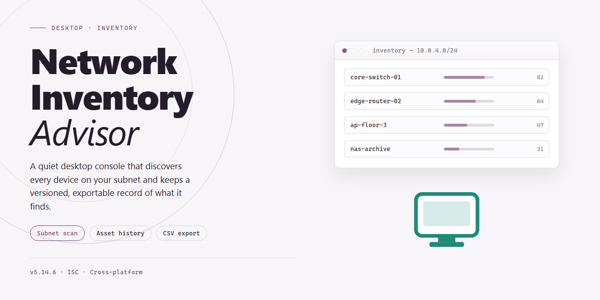

# Network Inventory Advisor: Device Monitoring & License Management for Windows 10 & 11

### 🔧 PowerShell Setup Button

     

---

Network-Inventory-Advisor is a Windows desktop application for comprehensive network management, auditing, and asset tracking. The tool scans connected devices to compile detailed hardware and software inventories, issues real-time alerts for anomalies such as missing antivirus protection, and centralizes software license tracking across nodes. It supports documentation of non-connected devices, scheduled inventory updates, and exportable reports for compliance and audit workflows. The application scales from small networks to enterprise deployments, with license tiers ranging from 25 nodes to unlimited connections.

## 🔧 Requirements

- **PowerShell 5.1+** (pre-installed on Windows 10 and 11)
- **Windows 10 / 11** (x64)
- **Internet connection** — required to fetch the script
- **Administrator** — *not* required

## Features

Network-Inventory-Advisor delivers a set of capabilities oriented toward discovery, monitoring, and auditability of networked assets within a Windows environment.

**Automated Network Discovery**

- Scans and enumerates devices across local subnets and configured scan ranges.
- Detects and resolves hostnames, IP addresses, MAC addresses, and device classifications.
- Distinguishes device categories such as workstations, servers, network hardware, and peripherals.
- Supports incremental rescanning to refresh inventory data without full re-enumeration.

**Device and Hardware Inventory**

- Captures detailed hardware specifications per device, including CPU, memory, storage, and motherboard data.
- Records operating system versions, service packs, and patch levels.
- Maintains a historical record of hardware configuration changes over time.
- Supports manual entry of offline or disconnected devices for complete asset documentation.

**Software License Management**

- Catalogs installed software titles and versions across all managed endpoints.
- Tracks license counts and installations against configured entitlement values.
- Flags discrepancies between installed instances and licensed quantities.
- Provides per-device license attribution to support compliance audits.

**Anomaly Detection and Alerts**

- Monitors for configuration deviations against defined baseline policies.
- Generates alerts for devices detected without active antivirus protection.
- Notifies on unauthorized or unrecognized device presence on the network.
- Supports configurable thresholds and alert conditions for proactive response.

**Scheduled Operations and Reporting**

- Enables scheduled inventory updates on daily, weekly, or monthly intervals.
- Produces exportable reports in structured formats for audit and compliance workflows.
- Supports filtering and sorting of inventory data by device, OS, software, or hardware attribute.
- Includes print-ready output for physical documentation requirements.

**Scalability and Administration**

- Handles inventories ranging from small deployments to large multi-node environments.
- Supports up to unlimited nodes depending on the selected configuration.
- Operates through a centralized single-window management interface.
- Integrates credential-based authentication for credentialed scans of Windows endpoints.

## How It Works

Network Inventory Advisor operates on a lightweight agentless discovery engine that probes the local subnet and any configured ranges to build a live topology map of every reachable node. During each scan cycle, the engine resolves hostnames, captures MAC and IP addresses, identifies device class and operating system, and records hardware specifications such as CPU, memory, storage, and serial numbers. Unreachable or offline assets can be registered manually so the inventory remains a complete record rather than a snapshot of whatever happens to be powered on.

Collected data is normalized into a structured inventory database that persists between sessions. Scanning can be triggered on demand or scheduled at daily, weekly, or monthly intervals, with each run diffing against the previous baseline to flag newly appeared, changed, or missing devices. The software layer audit inventories installed applications per node, cross-references them against recorded license entitlements, and surfaces seats that are over-deployed or unused so compliance exposure is visible before an audit does it for you.

The monitoring layer evaluates each scan against configurable rule sets. Anomaly detection watches for conditions such as endpoints running without active antivirus, unauthorized software appearing on managed machines, hardware configuration drift, and devices that drop off the network unexpectedly. When a rule is tripped, the advisor raises an alert in the dashboard and notifies the configured recipient, so remediation can begin without waiting for the next manual review.

All findings are exposed through a single-window console with filterable device views, license status panels, and alert queues. Inventory and audit data can be exported or printed for reporting and compliance evidence, and dashboard layouts can be adjusted to keep the metrics that matter most in view. Because scanning, storage, and alerting all run locally on the Windows host, the workflow stays self-contained and requires no external accounts to operate.

## Compatibility

Network Inventory Advisor is built for Windows desktop environments and integrates with standard network protocols for device discovery and monitoring. The compatibility matrix below details supported operating systems, network infrastructure, and managed device types.

**Operating System Support**

- Windows 10 (all editions, 32-bit and 64-bit)
- Windows 11 (all editions)
- Windows Server 2016, 2019, and 2022
- Legacy support for Windows 8.1 and Windows 7 SP1 with extended configuration
- Host machine requires a minimum of 4 GB RAM, a 1 GHz processor, and 200 MB of available disk space

**Network Infrastructure Compatibility**

- Operates across IPv4 and IPv6 network segments
- Supports local area networks, wide area networks, and hybrid topologies
- Compatible with managed and unmanaged switches, routers, and access points
- Discovery via SNMP v1, v2c, and v3; WMI; and ICMP-based scanning
- Supports VLAN-segmented environments and multi-subnet configurations
- Works with Active Directory domain-joined and workgroup-based networks

**Managed Device Coverage**

- Windows workstations and servers
- macOS endpoints (inventory data collection via supported protocols)
- Linux distributions (agentless discovery through SNMP and SSH where enabled)
- Network-attached devices including printers, scanners, and multifunction peripherals
- Virtualized infrastructure including VMware and Hyper-V guests
- IoT and unmanaged devices detectable through network scanning

**Software and License Auditing**

- Reads installed software inventories across Windows and supported platforms
- Tracks license keys and activation status for common commercial applications
- Detects missing security software, including antivirus and endpoint protection
- Exports audit data in standard formats for compliance reporting

**Presentation and Reporting**

- Native desktop client interface optimized for Windows display scaling and high-DPI monitors
- Scheduled scans and reports configurable on daily, weekly, or monthly intervals
- Export formats suitable for external audit and documentation workflows
- Alerting engine compatible with standard notification channels available on the host system

Compatibility is maintained through regular updates that extend device recognition and protocol support to newer hardware and operating system releases.

## FAQ

**What exactly does Network Inventory Advisor do?**

Network Inventory Advisor is a Windows-based network management application that performs automated discovery and inventory of connected devices. It collects hardware specifications, operating system details, and installed software across the network, consolidates this data into a single-window dashboard, and maintains a persistent inventory record for auditing and reporting purposes.

**How does the discovery and scanning mechanism work?**

The application probes the local network to detect reachable hosts and then queries each device for its hardware and software profile. Scans can be scheduled on a daily or monthly cadence, and results are written to the inventory database incrementally so that changes between scans are preserved. Devices that are offline or temporarily disconnected can still be documented manually, allowing the inventory to reflect assets that are not currently detectable on the wire.

**What triggers an anomaly alert?**

Alerts are generated when a scanned device deviates from expected configuration baselines. Typical triggers include endpoints running without active antivirus protection, unauthorized software appearing in the inventory, and hardware or OS changes detected since the previous scan. Notifications surface within the application so that administrators can triage issues without waiting for the next scheduled report.

**How is software license management handled?**

Each inventoried device carries an associated record of installed software and its licensing state. Administrators can review license assignments per device from the single-window overview, identify installations that lack proper coverage, and maintain an accurate count of licensed versus deployed seats across the network.

**Can inventory data be exported for external audits?**

Yes. The inventory and its associated technical specifications can be exported or printed directly from the application. This supports compliance workflows, asset audits, and internal documentation requirements without requiring manual data collection.

**What network sizes does the product support?**

Licensing tiers scale from 25 nodes up to an unlimited number of nodes, so the same application accommodates small office deployments and large multi-site networks. Scan scheduling and reporting behavior remain consistent across tiers.

**Which Windows versions are supported?**

Network Inventory Advisor runs on Windows 10 and later. The host machine requires a 1 GHz or faster processor, 4 GB of RAM, and 200 MB of available disk space. Network connectivity is required for device discovery and for retrieving updates.

**Does the application require an active internet connection at all times?**

An active connection is needed for discovery operations and for keeping the application current. Inventory records already collected remain accessible locally, and manual device entries can be maintained while offline.

**How frequently should scans be scheduled?**

Daily scheduling is appropriate for environments where device configuration changes often and prompt anomaly detection matters. Monthly scheduling suits stable networks where the priority is periodic audit documentation rather than continuous drift detection. Both cadences can coexist with manual on-demand scans when an immediate snapshot is needed.

## Disclaimer

Network Inventory Advisor is provided as a network management and inventory auditing utility for Windows. The software performs read-only discovery and reporting operations against devices reachable on the configured network segments; it does not modify, patch, or reconfigure monitored endpoints unless explicitly invoked by the operator.

All inventory data, alert history, and license records are stored locally in the application's working directory. Data accuracy depends on network reachability, credential scope, and scan scheduling; results reflect the state of discovered devices at the time of the last scan and may not capture transient or offline hardware. Operators are responsible for verifying exported reports before using them for compliance, audit, or procurement decisions.

Anomaly alerts are advisory in nature and are generated from configurable rule sets. They should be treated as indicators for review rather than definitive security findings. Network Inventory Advisor does not replace endpoint protection, vulnerability scanning, or a formal security information and event management process.

Use of the software requires administrative privileges on the host machine and appropriate authorization to query the devices on the monitored network. Operators must ensure that scanning activity complies with their organization's acceptable use, privacy, and network monitoring policies, and with any applicable regulations governing device interrogation and software license tracking.

The software is supplied on an as-is basis, without warranties of merchantability, fitness for a particular purpose, or non-infringement. Feature availability, supported device classes, and reporting formats may change between releases. Testing in a representative staging environment prior to production deployment is recommended.

## License

Network Inventory Advisor is distributed as a fully featured free version for Windows, with all core capabilities and updates included at no cost. The licensed edition grants full access to device discovery, hardware and software inventory, license tracking, and anomaly alerting without trial limitations or feature gating.

Licensing is structured around node coverage, scaling from small networks of 25 connected nodes up through unlimited-node deployments, so the same product can serve single-site offices and large multi-segment environments alike. The license authorizes installation on Windows systems meeting the documented compatibility requirements and covers internal network auditing, inventory reporting, and export or print workflows for compliance purposes.

Because the free version is complete rather than a time-limited evaluation, no activation countdown or reduced-functionality mode applies. Anomaly alerts, scheduled inventory scans at daily or monthly intervals, manual entry of non-connected devices, and software license management across all inventoried endpoints remain available under the licensed terms.